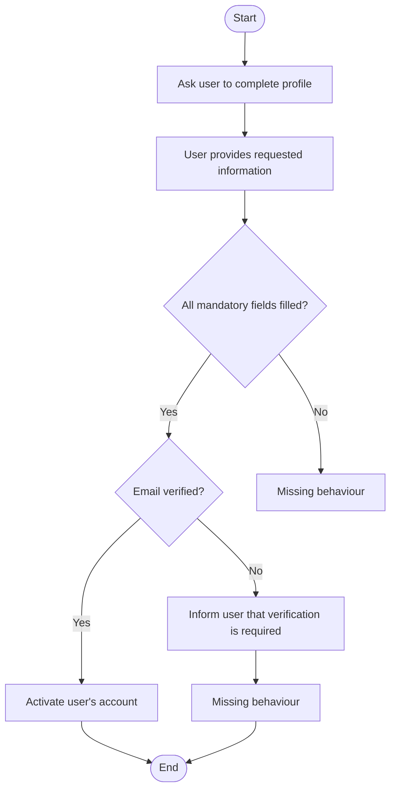

[← Back to Documentation - Home](index.md)

---

# AAMC – AI-Assisted Model Creation

AAMC (AI-Assisted Model Creation) is an AI-supported capability within TestCompass that helps transform behavioural descriptions into an initial TestCompass model draft.

It allows users to start modelling from requirements, user stories, workshop notes, business process descriptions, and other behavioural sources rather than creating a model manually from scratch.

The generated draft can then be reviewed, refined and extended within TestCompass.

---

## Purpose

AAMC is designed to accelerate the creation of initial TestCompass models from behavioural descriptions.

It provides a structured starting point that helps teams begin modelling earlier and spend more time reviewing, refining and exploring behaviour rather than creating a model from scratch.

---

# Supported Inputs

AAMC can process both natural-language and structured inputs, including:

Natural Language
- requirements
- user stories
- acceptance criteria
- scenarios
- domain descriptions
- workshop or discussion notes

Structured Inputs
- BPMN 2.0 XML
- JSON workflow definitions
- XML behaviour descriptions
- Mermaid diagrams
- Gherkin scenarios
- other machine-readable behavioural formats

---

# Generated Output

AAMC generates an initial TestCompass model draft containing:

- model structure
- actions
- decisions
- transitions
- behavioural flows

The generated model can immediately be reviewed, refined and further developed inside TestCompass.

After generation, TestCompass automatically validates the model and highlights any detected modelling or semantic issues directly within the model.

---

## Example: Generating an eMBT Model from Natural Language Requirements

AAMC converts natural language requirements into a structured, semantically consistent eMBT model.  
The example below demonstrates how AAMC interprets a short requirement, identifies decisions, and exposes incomplete behaviour without making assumptions.

---

### Input Requirement (English)

After creating an account, the system asks the user to complete their profile.
The user provides the requested information.
The system checks whether all mandatory fields are filled in.
If all mandatory fields are provided, the system verifies the user’s email address.
If the email is verified, the system activates the user’s account.
If the email is not verified, the system informs the user that verification is required.
(The requirement does not describe what happens if mandatory fields are missing.)
(The requirement does not describe what happens after informing the user about email verification.)

---

### Generated Model (Mermaid)
AAMC generates a full TestCompass model.
The Mermaid diagram shown below is only a documentation-friendly visualization of that model, not the model itself.

## Explanation
- AAMC performs the following:
- Identifies decisions (“All mandatory fields filled?”, “Email verified?”)
- Creates a clean, readable model without adding behaviour that is not explicitly described
- Leaves incomplete paths open, marking them as missing behaviour
- Ensures semantic correctness according to eMBT rules

This example illustrates how AAMC exposes ambiguity in requirements instead of hiding it, enabling teams to clarify missing behaviour early in the process.

---

## Example Workflow

1. Provide AAMC with behavioural input
2. Generate an initial model draft
3. Review and refine the generated model
4. Continue modelling within TestCompass
5. Use the refined model for test generation and impact analysis

This workflow supports early exploration, accelerates the modelling process and reduces the time needed to reach a stable, explicit model.

---

## Benefits

AAMC helps teams:

- start modelling earlier  
- reduce ambiguity
- identify missing behaviour
- challenge assumptions
- accelerate the path to testable models
- improve collaboration between testers, analysts, and developers
- lower the barrier to modelling
- provide a high‑quality first draft
- enable iterative refinement with AI
- increase modelling consistency
- support multiple input formats
- make behaviour explicit early
- strengthen early risk discovery
- improve traceability  

---

## History
AAMC was first publicly documented in this repository in May 2026.

---

## Contact

For more information about AAMC or the TestCompass eMBT workflow, please visit the website or reach out via LinkedIn.
