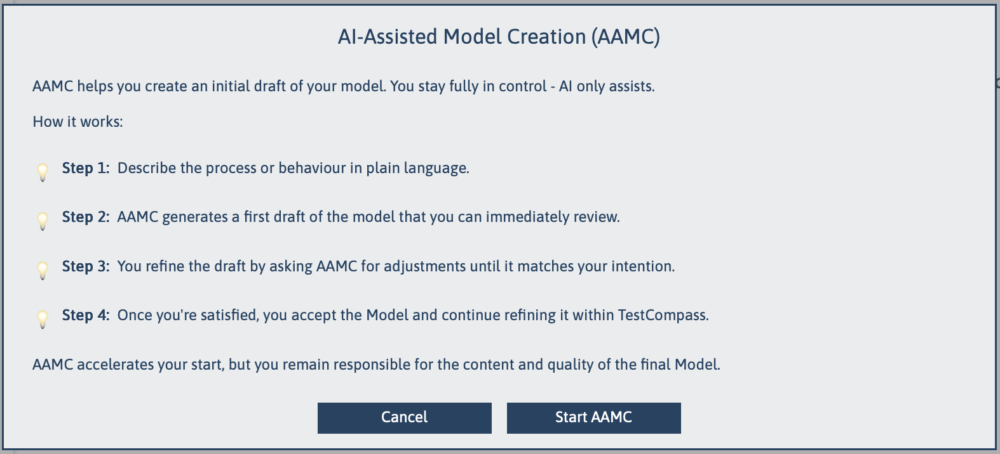
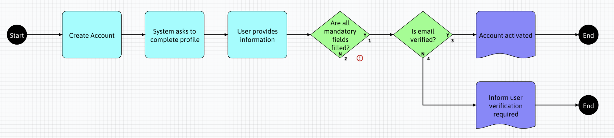

[← Back to Documentation Index](index.md)

# AAMC – AI-Assisted Model Creation

AAMC (AI-Assisted Model Creation) is an AI-supported feature within TestCompass that transforms behavioural descriptions into an initial TestCompass model draft.

It allows teams to start modelling directly from requirements, user stories, workshop notes or system specifications—rather than creating a model manually from scratch.

>  **Purpose & Role of AAMC**  
> AAMC is designed to accelerate the creation of initial TestCompass models. It acts as a modelling assistant, not a replacement for human expertise. It provides a structured starting point so teams can spend less time building models manually and more time analyzing behaviour, detecting gaps, contradictions and open ends in the requirements and  identifying risks early.

---

## Behavioural Characteristics & Best Practices

AAMC interprets input text, identifies actions, decisions, outcomes, and branching logic, and converts them into a visual TestCompass model draft in accordance with TestCompass modelling rules.

### Generative Nature & Iteration
Because generative AI is non-deterministic, the same input text may produce slightly different model interpretations. 
* **Model Regeneration:** If an initial draft contains structural inconsistencies or suboptimal flows, regenerating the model produces a fresh interpretation of the input.
* **User Control:** Users retain full control over whether to accept a generated draft, run another generation, or adjust the model manually in the workspace.

### Single Process Input Focus
For optimal results, input descriptions should focus on **one clear process from start to finish**.
* Providing requirements that contain multiple distinct processes, multiple primary actors, or unrelated parallel flows may result in disconnected model structures ("islands").
* Multi-process documentation should be provided to AAMC incrementally, one process at a time, to build focused and maintainable models.
* AAMC fully handles complex logic, decision trees, error paths and system validations as long as they belong to the same core process.

---

## Supported Inputs

AAMC processes unstructured natural language, tabular specifications, legacy diagram exports, and structured, machine-readable formats:

### Natural Language
- Requirements & Acceptance Criteria
- User Stories & Scenarios
- Domain Descriptions & Business Process Rules
- Workshop Notes & Discussion Summaries
- Other natural language text descriptions

### Tabular & Spreadsheet Specifications
- **Excel Decision Tables & Spreadsheets:** Tabular combinations of conditions, rules, and outcomes directly converted into branching decision logic.
- **CSV & Matrix Formats:** Tabular business logic, rule matrices, and decision grids.
- **Other tabular data formats** (e.g., Markdown tables, Word/Confluence tables, etc.)

### Structured & Machine-Readable Formats
- **BPMN 2.0 XML**
- **JSON Workflow Definitions**
- **XML Behaviour Descriptions**
- **Mermaid Diagrams** & **Gherkin Scenarios**
- **Diagram Conversions & OCR:** Text, JSON, or Mermaid exported from legacy diagramming tools (e.g., MS Visio, Lucidchart, Draw.io) or extracted from whiteboard photos.
- **Other structured, machine-readable text formats**

> 💡 **Legacy Model Migration & Input Versatility**  
> Teams transitioning to TestCompass can easily convert existing process models (such as MS Visio or Lucidchart flows) into structured formats like JSON, XML, or Mermaid and pass them to AAMC for instant migration into executable TestCompass model drafts. As long as logic, processes, or decision rules can be represented as text—whether in plain prose, spreadsheets, or machine-readable code, AAMC can analyze it and generate a compliant model draft.

---

## Model Validation & Handling Issues

After generation, TestCompass automatically validates the generated draft against the official TestCompass model rules:

* **Visual Validation Indicators (Red Exclamation Marks):** If a model violates any modelling rules—such as a Decision node with only 1 outgoing path instead of 2, an Action node without an outgoing transition, or isolated nodes—TestCompass highlights these issues directly on the canvas with red exclamation marks.
* **Resolution Strategy:** When a generated draft contains multiple structural rule violations, clicking **Regenerate** is generally faster than manual correction. For minor issues (such as a single missing link), accepting the draft and fixing it directly in the editor or reviewing the **Test tab** is recommended.
 

  

---

## Example: Generating an eMBT Model from Requirements

The example below demonstrates how AAMC converts a short natural language requirement into a structured, semantically consistent TestCompass model while exposing incomplete logic.

---

### 1. Input Requirement (English)

> After creating an account, the system asks the user to complete their profile.  
> The user provides the requested information.  
> The system checks whether all mandatory fields are filled in.  
> If all mandatory fields are provided, the system verifies the user’s email address.  
> If the email is verified, the system activates the user’s account.  
> If the email is not verified, the system informs the user that verification is required.

---

### 2. Generated Model Draft

AAMC generates an initial model draft directly inside TestCompass:

  

---

### 3. Key Takeaways from the Generated Model

- **Explicit Decisions:** Automatically identifies key branching logic (*"All mandatory fields filled in?"*, *"Email verified?"*).
- **No Unsafe Assumptions:** AAMC does not guess or invent logic for unspecified paths (e.g., what happens if mandatory fields are missing).
- **Exposing Incomplete Behaviour (Red Exclamation Marks):** Unspecified outcomes are deliberately left open. Because an open path violates the TestCompass model rules (e.g., a decision missing an outgoing path), TestCompass automatically flags it with a red exclamation mark on the canvas so teams can identify and resolve requirement gaps early.

---

> **Key Takeaway**  
> AAMC bridges the gap between text requirements and visual modelling in seconds. It exposes ambiguity early, providing a clean baseline to refine, execute impact analysis on, and derive test scenarios from.
