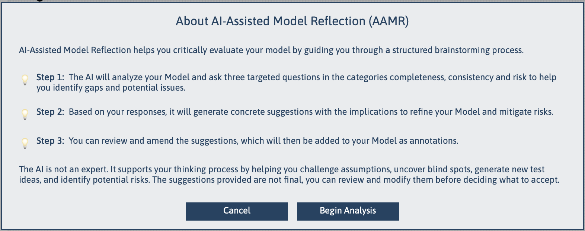

[← Back to Documentation Index](index.md)

# AAMR – AI-Assisted Model Reflection

AAMR (AI-Assisted Model Reflection) is an AI-supported capability within TestCompass that helps users critically review and improve existing models.

Rather than generating a model, AAMR analyses a model and presents observations, questions, and alternative perspectives that may help identify gaps, ambiguities, and potential risks.

AAMR is designed to support reflective thinking while keeping all modelling decisions strictly under the control of the tester.

---

## Purpose

>  **The Power of Reflection**  
> AAMR acts as a collaborative modelling partner that encourages critical thinking and discussion. 

AAMR helps users:
- **Examine behavioural models** from different perspectives
- **Identify possible gaps or ambiguities** in decision logic
- **Challenge hidden assumptions** between business and technical stakeholders
- **Explore alternative interpretations** of system behaviour
- **Improve model quality and consistency** before test generation
- **Support collaborative model reviews** within the team

---

## How AAMR Works

AAMR analyses the structure and semantics of a TestCompass model and generates reflections such as:

-  **Clarification questions** about decision branches and states
-  **Observations** about model structure and flow
-  **Potential ambiguities** or unhandled paths
-  **Potentially missing behaviour** or exception handling
-  **Alternative interpretations** of requirements
-  **Risk-oriented discussion points** for team reviews
-  **Model improvement suggestions**

*(Note: The purpose of these reflections is to stimulate analysis and discussion, not to automatically modify the model.)*

  

---

## Example Reflections

When analysing a model, AAMR may generate questions such as:

- *What happens if this decision evaluates to "No"?*
- *Is this outcome always valid under all boundary conditions?*
- *Can a user return to a previous state, or is the flow strictly one-way?*
- *Are all exception paths and error scenarios represented?*
- *Does this process have a clearly defined termination point?*
- *Could different stakeholders interpret this behaviour differently?*

These questions help expose uncertainty and encourage deeper examination of the model during review sessions.

---

## Typical Workflow

1. **Create or import** a model into TestCompass.
2. **Run AAMR** on the model.
3. **Review** the generated reflections and questions.
4. **Discuss and evaluate** the observations with your team.
5. **Refine the model** where necessary.
6. **Continue** with test generation and impact analysis.

---

## What AAMR Is Not

AAMR is **not**:
- an automatic model corrector
- a model generation tool
- a replacement for human modelling expertise
- a system that determines the single "correct" answer
- a mechanism that automatically changes models

>  **Human-in-the-Loop**  
> The final modelling decisions and interpretations always remain fully with the tester.

---

## Relationship with AAMC

AAMC and AAMR address different, complementary stages of the modelling workflow:

###  AAMC (AI-Assisted Model Creation)
- **Focus:** Jumpstarting the process.
- **Goal:** Helps create an initial model draft from raw behavioural descriptions or text.

###  AAMR (AI-Assisted Model Reflection)
- **Focus:** Strengthening and challenging.
- **Goal:** Helps review, challenge, and refine an existing model by uncovering gaps, risks, and assumptions.

Together, AAMC and AAMR support both the rapid creation and the continuous, critical improvement of TestCompass models.

---

## Contact

For more information about AAMR or the TestCompass eMBT workflow, please visit the website or reach out via LinkedIn.
