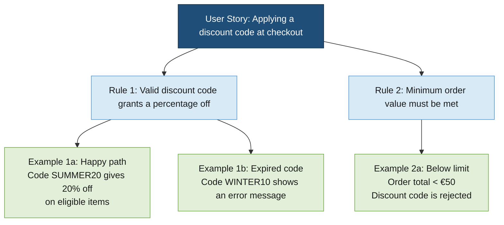

[← Back to Documentation Index](index.md)

# BDD Requirements Discovery & Gherkin Integration

Effective testing starts long before code is written. It begins with a shared understanding of requirements. TestCompass bridges the gap between high-level requirements and executable specifications by supporting collaborative Behaviour-Driven Development (BDD) discovery practices, such as **Feature Mapping** and **Example Mapping**.

These practices align closely with industry-proven principles from BDD authorities like **John Ferguson Smart** (author of *BDD in Action*), emphasizing that discovering rules and concrete examples together prevents costly ambiguities and aligns business, development and testing from day one.

> **Core Purpose**  
> TestCompass integrates collaborative requirements discovery directly into your workflow, allowing teams to seamlessly transform discovery maps into explicit behavioural models and automatically derive executable Gherkin specifications.

---

## The Philosophy of BDD Discovery in eMBT

Traditional BDD often suffers from a disconnect: discovery sessions (like Example Mapping) take place on whiteboards or sticky-note tools, after which specifications and tests are written manually, leading to drift and maintenance overhead.

TestCompass treats discovery as the **first phase of eMBT (Exploratory)**:
1. **From Board to Model:** Discovery artifacts (rules, triggers, outcomes) are translated directly into explicit decision models.
2. **From Model to Code:** Once the model is validated and a test coverage strategy is applied, TestCompass automatically generates clean, structured **Gherkin feature files (`.feature`)**.
3. **Living Specifications:** Because everything is anchored to the model, requirement changes instantly trigger impact analyses on your Gherkin scenarios.

---

## Conceptual Example: "Orders Cancelled Late"

Following principles established by BDD experts like *John Ferguson Smart*, capturing behaviour starts with clear business rules and concrete examples:

* **Business Rule:** *Orders cancelled less than 5 minutes before pickup time incur a $1.00 fee.*
* **Feature Mapping:** The team maps out the rule, the trigger condition, and concrete examples during collaborative sessions.
* **Model Translation:** The rule is captured as an explicit decision flow within TestCompass.
* **Automatic Gherkin Generation:** TestCompass derives the corresponding Gherkin feature file complete with `Background`, `Scenario Outline`, and concrete examples.

```gherkin
Feature: Orders cancelled late
  As a customer
  I want to cancel my order
  So that I am not charged incorrectly

  Background:
    Given a valid user account
    And an active order

  Scenario Outline: Cancel order near pickup time
    Given the order is placed
    When the cancellation is requested <TimeBeforePickup> minutes before pickup
    Then the system should evaluate the late cancellation rule
    And the resulting fee should be <ExpectedFee>

    Examples:
      | TimeBeforePickup | ExpectedFee |
      | 15               | $0.00       |
      | 3                | $1.00       |
```

---

## Continuous Alignment & Impact Analysis

Requirements frequently evolve during a sprint. In a traditional BDD workflow, updating feature files and test scripts manually is tedious and error-prone. 

With TestCompass:
- **Model-Centric Updates:** You update the business logic in the model, not the text files.
- **Automated Impact Analysis:** TestCompass detects exactly which generated scenarios and Gherkin features are added, removed or updated.
- **Synchronized Artifacts:** Your documentation, models, and acceptance criteria remain 100% aligned at all times.

---

> **Key Takeaway**  
> By uniting BDD discovery, visual modelling and automated Gherkin generation into a single continuous loop, TestCompass ensures that your acceptance criteria and test suites remain alive, accurate and completely synchronized.

---

## Practical Walkthrough: From Example Map to TestCompass Model

This walkthrough demonstrates how to convert a BDD Example Mapping session into a fully functional test model in TestCompass using AI-assisted translation.

### Step 1: The Example Map (Input)
During a Discovery session, the team captures the story rules and examples:

* **User Story:** Applying a discount code at checkout.
* **Rule 1:** Valid discount code grants a percentage off.
  * **Example 1a (Happy path):** Code "SUMMER20" gives 20% off on eligible items.
  * **Example 1b (Expired code):** Expired code "WINTER10" shows error message.
* **Rule 2:** Minimum order value must be met.
  * **Example 2a (Below limit):** Order total < €50 rejects discount code.

### Step 2: AI Prompt to Generate Mermaid or Gherkin
You can pass the outcome of your Example Map into an LLM (e.g., ChatGPT / Claude) using the prompt below:

> **AI Prompt Example:**  
> "Act as a QA Automation Specialist. Convert the following BDD Example Map into a valid Mermaid flowchart or Gherkin syntax that represents the decision logic:  
>   
> [Paste your Example Map here]  
>   
> Ensure all decision nodes (rules) and outcomes (examples) are clearly structured."

### Step 3: Generated Mermaid Flowchart Code
The AI outputs the following Mermaid diagram structure:




---

## Navigation

⬅️ **[Back to Documentation Index](index.md)**
