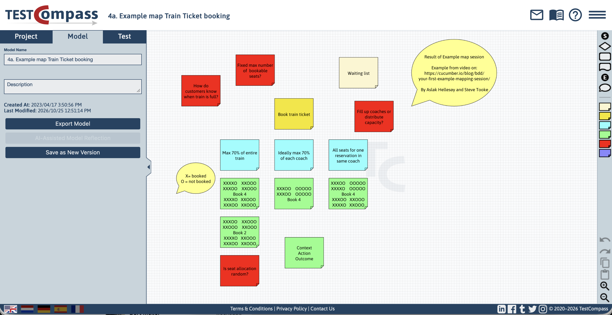

[← Back to Documentation Index](index.md)

# BDD Requirements Discovery & Gherkin Integration

Effective testing starts long before code is written. It begins with a shared understanding of requirements. TestCompass bridges the gap between high-level requirements and executable specifications by supporting collaborative Behaviour-Driven Development (BDD) discovery practices, such as Feature Mapping and Example Mapping.

These practices align with proven principles from BDD authorities like John Ferguson Smart (author of *BDD in Action*), emphasizing that discovering rules and concrete examples together prevents ambiguities and aligns business, development, and testing from day one.

> **Core Purpose**  
> TestCompass integrates collaborative requirements discovery directly into your workflow, allowing teams to turn discovery maps into explicit behavioural models and automatically derive executable Gherkin specifications.

---

## The Philosophy of BDD Discovery in eMBT

Traditional BDD often suffers from a disconnect because discovery sessions like Example Mapping take place on whiteboards or sticky-note tools, after which specifications and tests are written manually, leading to maintenance overhead.

TestCompass treats discovery as the first phase of eMBT (Exploratory):
1. **In-Tool Collaborative Discovery:** Instead of relying on external whiteboards, teams can run Example Mapping and Feature Mapping sessions directly within TestCompass using dedicated Sticky Note nodes.
2. **From Board to Model:** Discovery artifacts captured on the canvas are translated into explicit test models, either manually or by using AI (AAMC) to convert the map into a TestCompass model.
3. **Coverage-Based Feature File Generation:** Rather than drafting Gherkin files scenario by scenario, TestCompass automatically generates structured Gherkin `.feature` files based on your selected coverage strategy.
4. **Data-Driven Scenario Outlines:** By defining test data variations within node details, TestCompass automatically generates `Scenario Outline` specifications complete with populated `Examples:` tables.
5. **Living Specifications & Easy Maintenance:** When requirements evolve, you update the visual model and regenerate the complete `.feature` file with a single click, eliminating manual scenario maintenance.

---

---

## Continuous Alignment & Impact Analysis

Requirements frequently evolve during a sprint. In a traditional BDD workflow, updating feature files and test scripts manually is tedious and error-prone. 

With TestCompass:
- **Model-Centric Updates:** You update the business logic in the model, not the text files.
- **Automated Impact Analysis:** TestCompass detects exactly which generated scenarios and Gherkin features are added, removed, or updated.
- **Synchronized Artifacts:** Your documentation, models, and acceptance criteria remain fully aligned at all times.

---

> **Key Takeaway**  
> By uniting BDD discovery, visual modelling, and automated Gherkin generation into a single continuous loop, TestCompass ensures that your acceptance criteria and test suites remain accurate and completely synchronized.

---

## Practical Walkthrough: From Example Map to TestCompass Model

This walkthrough demonstrates how to convert a BDD Example Mapping session into a functional test model in TestCompass using AI-assisted translation.

### Step 1: The Example Map (Input)
During a discovery session, the team captures story rules and examples.

### Step 2: AI Prompt to Generate Gherkin or Decision Logic
You can pass the outcome of your Example Map into an LLM using the prompt below:

> **AI Prompt Example:**  
> "Act as a QA Automation Specialist. Convert the following BDD Example Map into structured Gherkin feature files or decision logic:  
>  
> [Paste your Example Map here]  
>  
> Ensure all decision nodes (rules) and outcomes (examples) are clearly structured."

### Step 3: Import into TestCompass (AAMC)
1. Open **TestCompass** and create a new model using **AI Assisted Model Creation (AAMC)**.
2. Paste the generated Gherkin syntax or decision logic directly into the input field.
3. Click **Generate Model**. TestCompass converts the syntax directly into a visual decision model.
4. Adjust the model if needed or accept it to add it to your project workflow.

### Step 4: Generate Gherkin Feature Files Based on Coverage
Once your model is finalized and validated in TestCompass, you can derive executable specifications automatically:
1. Select your desired coverage strategy (such as Node, Edge, or Full Path Coverage).
2. TestCompass calculates the test scenarios and automatically generates structured Gherkin `.feature` files, complete with populated `Examples:` tables for data variations.
3. Use the `.feature` file in your test automation framework (like Cucumber or SpecFlow) to start testing.

---

## Navigation

⬅️ **[Back to Documentation Index](index.md)**
