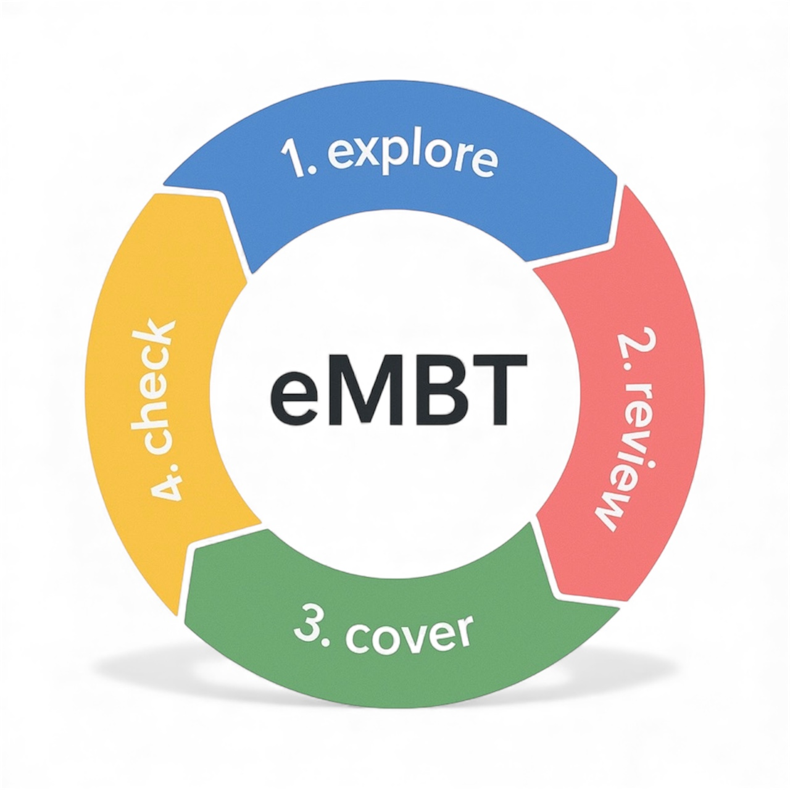

[← Back to Documentation - Home](index.md)

# Early Model-Based Testing (eMBT)

Early Model-Based Testing (eMBT) is a collaborative, model-driven testing approach that helps teams achieve a shared understanding of requirements early in the software development lifecycle.  
It improves communication between business and technical stakeholders and optimizes the test design phase.

eMBT consists of four iterative phases.

---

## 1. Exploratory Phase
In this phase, the team explores and visualizes the requirements.  
The goal is to identify:

- ambiguities  
- inconsistencies  
- open ends  
- hidden assumptions  

A graphical test model is created to make behaviour explicit.  
The model acts as a shared thinking tool that immediately triggers discussion and reveals misunderstandings.

---

## 2. Review Phase
All questions and uncertainties raised during the exploratory phase are reviewed with the full team.  
Business and IT validate:

- the meaning of the requirements  
- business rules and decisions  
- boundary conditions  
- exceptions  

This phase is iterative.  
Every change in the requirements leads to an updated model and a new review cycle.

---

## 3. Coverage Phase
Once the model is complete and validated, test cases are automatically generated based on the selected coverage level.

The following coverage forms are commonly used:

- **Node coverage (NC)**  
- **Edge coverage (EC)**  
- **Path Pair coverage (PPC)**  
- **Path Triple coverage (PTC)**  
- **Full Path coverage (FPC)**  

The chosen coverage level depends on risk, priority, and desired thoroughness.

---

## 4. Checking Phase
The generated test cases are executed against the system under test.  
Depending on the nature of the test, execution may be:

- manual  
- automated  
- or a combination of both  

The goal is to verify that the system behaves exactly as described in the model.

---

## Impact Analysis
Because requirements change continuously, eMBT includes a structured way to manage change.  
When the model is updated, an impact analysis shows which test cases are:

- added  
- removed  
- updated  
- unchanged  

This prevents unnecessary test work and reduces false positives and false negatives.

---

## Why eMBT?
eMBT helps teams:

- clarify requirements early  
- reduce misunderstandings  
- identify risks sooner  
- manage change effectively  
- design tests systematically  
- ensure business value is protected  

---

## Relation to TestCompass
TestCompass supports the full eMBT workflow:

- modelling (Exploratory)  
- reviewing and iteration (Review)  
- automated test generation (Coverage)  
- impact analysis and execution support (Checking)

In addition, TestCompass provides AI-assistance through:

- **AAMC** – AI-Assisted Model Creation  
- **AAMR** – AI-Assisted Model Reflection  

These capabilities accelerate modelling and improve the quality of reasoning.
