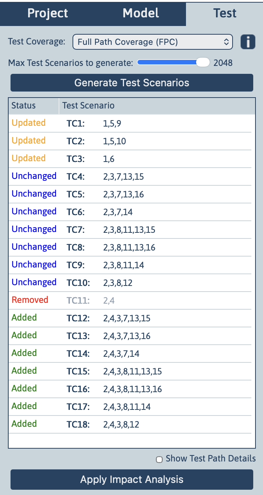

[← Back to Documentation Index](index.md)

# Impact Analysis

Impact analysis in TestCompass helps teams understand how changes in requirements affect existing behaviour, models, and generated test scenarios.  
Because requirements evolve continuously, impact analysis ensures that test scenarios remain accurate, relevant, and aligned with the latest understanding of the system.

> 🎯 **Core Purpose**  
> When behaviour changes, the model changes—and therefore the test scenarios change as well. Impact analysis automatically tracks these changes to prevent unnecessary rework and reduce the risk of false positives and false negatives.

This page explains the purpose of impact analysis, how it relates to modelling and test generation, and how TestCompass supports a structured approach to managing change.

---

## Purpose of Impact Analysis

Impact analysis answers four essential questions when behaviour changes:

- **What behaviour has been added?**  
- **What behaviour has been removed?**  
- **What behaviour has changed?**  
- **What behaviour remains valid?**  

By identifying these differences automatically, TestCompass saves valuable time during maintenance and keeps the test suite reliable.

---

## How Impact Analysis Works Conceptually

Impact analysis compares two versions of the same model:

1. **The previous version** (before the change)  
2. **The updated version** (after the change)  

TestCompass examines structural differences, changes in decision logic, updated node labels, added or removed paths, and modified boundaries. Based on this comparison, each generated test scenario receives a specific status.

---

## Test Scenario Status Types

Each scenario is classified into one of four categories:

### Added
New behaviour has been introduced, resulting in new test scenarios.

### Removed
Behaviour no longer exists in the updated model, making the scenario obsolete.

### Updated
Behaviour still exists, but the path, logic, or data has changed.

### Unchanged
The scenario remains valid and requires no modification.

This classification provides immediate insight into the scope and impact of the change.

  

---

## Why Impact Analysis Matters

Impact analysis supports:

- **Continuous testing** — Test scenarios stay aligned with evolving requirements.  
- **Reduced maintenance effort** — Only affected test scenarios require attention.  
- **Traceability** — Teams can see exactly why a test scenario changed.  
- **Risk management** — Changes in critical behaviour become visible early.  
- **Efficient collaboration** — Business and IT can discuss the impact of requirement changes with a shared visual reference.  

---

## Relationship to Modelling

Impact analysis is only possible because TestCompass uses explicit behavioural models.  
When the model changes, the impact becomes:

- visible  
- explainable  
- traceable  

➡️ **Learn more:** [Modelling](modelling.md)

---

## Relationship to Test Generation

After running impact analysis, teams can:

- regenerate test scenarios  
- update only the affected ones  
- maintain a clean, consistent test suite  

This ensures that generated test scenarios always reflect the latest version of the test model.

➡️ **Learn more:** [Test Generation and Coverage](test-generation.md)

---

> 🚀 **Key Takeaway**  
> Impact analysis ensures that change is not disruptive but manageable. It keeps your models, tests, and team understanding fully aligned as the system evolves.
