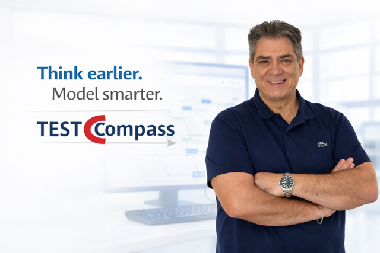

# TestCompass Documentation

Welcome to the official documentation for **TestCompass**, an early Model-Based Testing (eMBT) platform designed to help teams reason clearly, uncover risks early, and build shared understanding before code is written.

Built upon more than 30 years of practical domain expertise in software testing and quality engineering, eMBT is a proven methodology widely adopted in practice, embedded in professional software testing curricula and taught as a core component within software engineering programs across various Universities.

Testing tools are everywhere, focusing on automation, execution, or management. Few tools, however, help teams truly think about testing itself: exploring assumptions, uncovering risks, surfacing implicit requirements and understanding how a system really behaves before test cases are created or test execution starts. **That is exactly what TestCompass does.**

  

---

> **Core Purpose & Philosophy**  
> Requirements often describe only the intended "happy path." While AI now can generate test cases directly from text in seconds, speed alone cannot replace understanding. If initial requirements are incomplete, AI simply scales those gaps. TestCompass combines decades of field-tested testing expertise with modern AI assistance, shifting the focus from producing volume for volume’s sake to building shared understanding, exposing ambiguity early and turning implicit assumptions into explicit, executable model coverage.

---

## Getting Started

If you are new to TestCompass or early Model-Based Testing, start here:

- **[Overview](overview.md)** — Learn what TestCompass is, why early MBT matters, and how it fits into modern delivery workflows.
- **[The eMBT Approach](eMBT-approach.md)** — Understand the 4-phase eMBT workflow: Exploratory, Review, Coverage, and Checking.
- **[Quick Start Guide](qsg.md)** — Learn how the in-app guided tour connects to this documentation.

---

## Core Workflow & Modelling

Learn how to build, validate, and reason about explicit behavioural models:

- **[Behavioural Modelling](modelling.md)** — Foundations of flowchart-based modelling, node types, and requirements discovery.
- **[Mermaid Import & Export](mermaid-import-export.md)** — Bi-directional sync between text-based Mermaid diagrams and testable eMBT models.
- **[BDD-discovery & Formulation](bdd-discovery.md)** — BDD phases discovery and formulation supported by TestCompass.
   
---

## AI-Assisted Testing

Explore how AI acts as an accelerator and a thinking partner in TestCompass:

- **[AAMC – AI-Assisted Model Creation](aamc.md)** — Draft initial, semantically correct models from user stories, spreadsheets, or legacy diagrams in seconds.
- **[AAMR – AI-Assisted Model Reflection](aamr.md)** — Uncover hidden assumptions, missing paths, and risks through interactive, 3-question AI reflection loops.

---

## Test Generation & Impact Analysis

Turn models into systematic test suites and maintain them effortlessly over time:

- **[Test Generation and Coverage](test-generation.md)** — Derive test scenarios automatically based on Node, Edge, Path Pair, Path Triple, and Full Path Coverage.
- **[Impact Analysis](impact-analysis.md)** — Automatically detect Added, Removed, Updated, and Unchanged scenarios as requirements evolve.

---

## Integrations & Export Formats

Connect TestCompass into your daily tools and pipelines:

- **[Export Formats](export-formats.md)** — Overview of Excel (Test Design & Decision Tables), Gherkin (`.feature`), CSV, PNG, and native `.tcmodel` formats.
- **[Integrations](integrations.md)** — How TestCompass works alongside Azure DevOps, Jira, Zephyr, Xray, and other test management tools.

---

---

## Example: Beyond the "Happy Path"

Consider a typical workflow: *a user submits an order, payment is authorized, the order is confirmed, and eventually canceled.* 

Written requirements rarely cover all edge cases. Visualizing this workflow in TestCompass immediately surfaces critical questions:
- *Can cancellation occur before payment authorization?*
- *What happens if payment authorization is delayed or times out?*
- *Can the same state be entered twice unintentionally?*

These insights, surfaced before development begins, turn assumptions into shared knowledge and produce test scenarios grounded in complete confidence.

---

## About the Creator & The Origin of 'early Model Based Testing' (eMBT)

**TestCompass was created by Silvio Cacace**, bringing over **30 years of practical domain expertise** in software testing, quality engineering, and Model-Based Testing. 

Throughout three decades of leading test transformations across enterprise environments, Silvio recognized that most defects stem from incomplete specifications and implicit assumptions long before code is written. To bridge the gap between complex requirements and clear test coverage, he established the early Model-Based Testing (eMBT) methodology and created TestCompass to bring this collaborative approach into daily agile delivery. 

Today, eMBT is widely applied in mission-critical corporate environments, embedded in professional testing frameworks, and taught within software engineering programs across multiple universities.

 

---

> **Summary**  
> Explore the topics above to master intent-driven early Model-Based Testing—from your first model draft to continuous, automated test execution.

---
