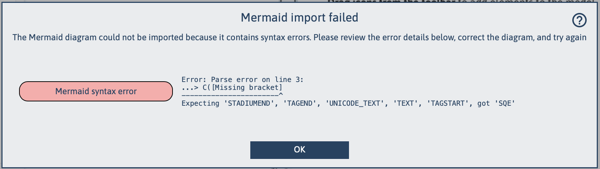
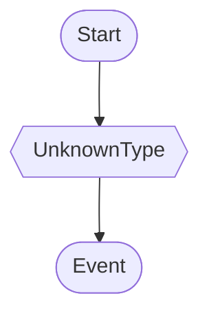
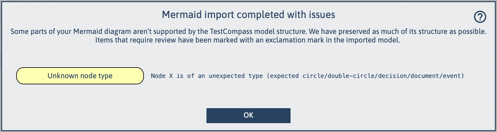
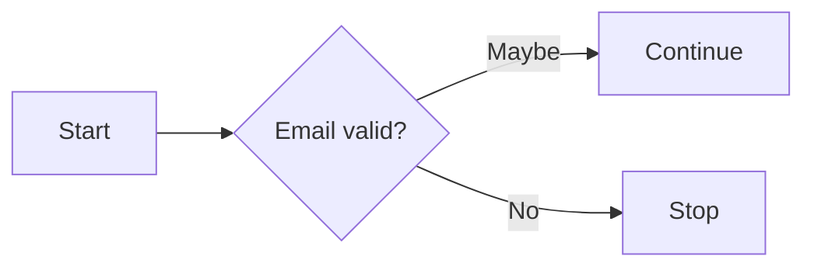
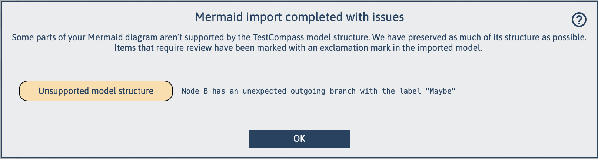

[← Back to Documentation Index](index.md)

# Mermaid Import & Export

Mermaid import and export in TestCompass help teams exchange models across documentation, development, and quality engineering workflows. Because Mermaid is an open, text-based notation, it supports transparent collaboration, version control, and clear code reviews in Git.

> **Core Purpose**  
> Mermaid serves as a text-based interchange format, enabling teams to embed visual models in documentation and track version changes in Git while maintaining clear modelling rules needed for coverage.

This page explains the purpose of Mermaid import and export, how they relate to behavioural modelling, and how TestCompass ensures consistency between text-based diagrams and executable eMBT test models.

---

## Purpose of Mermaid Import & Export

Mermaid import and export enable teams to:

- **Protect and reuse existing assets:** easily convert legacy process models from Visio, BPMN tools, Lucidchart, and Draw.io into Mermaid syntax and import them directly into TestCompass.
- **Include models directly in documentation:** seamlessly render behavioural models within Markdown files, wikis, and GitHub or GitLab repository documentation.
- **Maintain version control in Git:** store models as plain-text files with clean, readable line-by-line diffs during pull requests and code reviews.
- **Reconstruct and evolve models:** convert text-based Mermaid code back into fully interactive, testable TestCompass visual models at any time.
- **Keep everyone aligned on the same model:** keep system behavior synchronized across Product Owners, Developers, and QA Engineers.

By supporting Mermaid as an interchange format, TestCompass eliminates manual re-keying of existing process flows, improves traceability, and bridges the gap between system design, documentation, and automated test derivation.

---

## Import: From Text Diagram to Testable Model

When importing a Mermaid diagram, TestCompass automatically converts the diagram into a structured eMBT model. During import, TestCompass:

- interprets nodes and transitions according to explicit eMBT semantics
- validates the model structure and highlights logical inconsistencies
- preserves incomplete or ambiguous paths for review
- prevents hidden logic or implicit decision branches from being introduced

If a source Mermaid diagram uses unsupported syntax or breaks eMBT structural rules, clear guidance is provided so the diagram can be adjusted for test generation.

*(Tip: You can also use **AAMC – AI-Assisted Model Creation** to automatically generate or fix Mermaid diagrams from raw user stories before importing).*

---

## Export: From Model to Living Documentation

When exporting a model, TestCompass generates Mermaid syntax that reflects the exact structure and semantics of the underlying visual eMBT model. The exported Mermaid code:

- is deterministic and optimized for version control in Git
- can be embedded directly in `README.md` files, wikis, and architecture design documents
- provides a human-readable, visual view of system intent for non-modelling stakeholders
- maintains full structural alignment with the underlying TestCompass model

Exported diagrams support ongoing communication and traceability, while the TestCompass model remains the authoritative source for **coverage calculation, Gherkin generation, Excel Test Design, and impact analysis**.

---

## Relationship to Modelling & eMBT Workflow

Mermaid import and export complement the core TestCompass modelling workflow. They make system behaviour visible across documentation repositories, while TestCompass ensures that the model itself remains:

- **Explicit:** every decision branch (`Yes`/`No`) and outcome is clearly defined.
- **Semantically Correct:** ready for mathematical coverage strategies (Node, Edge, Path Pair, Path Triple, Full Path Coverage).
- **Traceable:** linked to stakeholder intent, preconditions, and test data variations.
- **Maintainable:** supported by automated impact analysis when requirements change.

---

## AI-Assisted Mermaid Conversion (James Bach Skill)

While TestCompass supports standard Mermaid imports, not every valid diagram can be converted directly into a testable eMBT model. TestCompass enforces specific modelling rules to guarantee that mathematical graph coverage algorithms can generate valid test paths.

To support this conversion process, James Bach created a Claude Code skill that analyses Mermaid diagrams, identifies conflicts with TestCompass modelling rules, and assists in producing a fully compatible eMBT model syntax.

This community-contributed resource is particularly useful when adapting complex legacy diagrams or external Mermaid definitions for import into TestCompass.

🔗 **[Download James Bach Claude Code Skill](https://github.com/silviocacace/TestCompass/blob/master/tools/testcompass-claude-code-skill.zip)**

*Special thanks to James Bach for creating and sharing this skill with the TestCompass community.*

*(Note: This skill is an independent contribution from James Bach and is not part of the core TestCompass product.)*

---

## Import Resilience & Validation Rules

When importing a Mermaid diagram, TestCompass adopts a **best-effort approach**. It will always attempt to import as much of your diagram structure as possible, even if the input contains syntax errors, unsupported elements, or violates internal model rules. 

Instead of rejecting the import entirely, TestCompass will flag problematic areas using visual warnings (such as exclamation marks on nodes or links) and provide a clear summary of what needs attention. 

To ensure your imported model is fully compliant and ready for automated test generation, TestCompass evaluates the structure against the following core **Model Rules**:

### Structural & Connectivity Rules
- **Single Start Node:** The model must contain exactly 1 start node.
- **End Nodes:** The model must contain at least one end node.
- **Valid Links:** All links must connect to a valid node on either end.
- **No Self-Links:** A node must not link to itself.
- **No Duplicate Links:** A link must not be duplicated.

### Node Flow Requirements
- **Start Node:** Must not have any incoming links, and must have exactly 1 outgoing link.
- **Statement & Result Nodes:** Must have at least one incoming link and exactly one outgoing link.
- **Decision Nodes:** Must have at least one incoming link, exactly one outgoing `"yes"` link, and one outgoing `"no"` link. Incoming links directly to `"yes"` or `"no"` sides are not allowed.
- **End Nodes:** Must have at least one incoming link and must not have any outgoing links.
- **Comment & Note Nodes:** Must not have any incoming or outgoing links (must remain standalone).

### Reachability & Path Integrity
- **Start Reachability:** All nodes (except Comment and Note nodes) must be reachable by at least one path from the Start node.
- **End Reachability:** All nodes (except Comment and Note nodes) must have at least one outgoing path which reaches an End node.

---

## Troubleshooting Import Dialogs & Warnings

After you import Mermaid code, TestCompass shows one of two dialogs. Click the **Help (`?`)** icon in the dialog to return to this page.

| Dialog | Meaning |
|---|---|
| **Mermaid import failed** | The Mermaid code contains a syntax error. Nothing is imported. |
| **Mermaid import completed with issues** | The diagram was imported, but some parts are not supported or break model rules. Items that need review are marked with an exclamation mark in the model in TestCompass. |

Each issue in a dialog has a coloured label:

| Label | Colour | Dialog |
|---|---|---|
| [1. Mermaid syntax error](#mermaid-syntax-error) | Red | Import failed |
| [2. Unknown node type](#unknown-node-type) | Yellow | Completed with issues |
| [3. Unsupported model structure](#unsupported-model-structure) | Orange | Completed with issues |

---

### 1. Mermaid syntax error
The Mermaid code cannot be parsed, so no model is created. The dialog shows the line number, the offending text and what the parser expected.

**Example** (invalid Mermaid, shown as plain text)

```text
flowchart TD
    A([Start]) --> B([Event])
    B --> C([Missing bracket]
```
**Message in TestCompass**



**Cause:** The node on line 3 is opened with `([` but closed with `]` instead of `])`.

**Fix:** Close the shape with `])` instead of `]`, so line 3 becomes `B --> C([Missing bracket])`. Then import again.

---

### 2. Unknown node type

The diagram uses a shape that TestCompass cannot map to a node type. The diagram is still imported, and the node is shown as `[Unknown Node Type]` and marked with an exclamation mark in TestCompass. Supported types are: `circle`, `double-circle`, `decision`, `document` and `event`.

**Example**



**Message in TestCompass**



**Cause:** Node `X` uses the hexagon shape `{{ }}`, which has no equivalent in TestCompass. Other shapes that are not supported are, for example, the cylinder `[( )]` and `manual-input`.

**Fix:** Replace the shape with a supported one in the mermaid code, or change the node type in the imported model in TestCompass.

---

### 3, Unsupported model structure

The diagram is valid Mermaid, but the structure does not follow the eMBT model rules. The diagram is still imported and the affected items are marked with an exclamation mark in TestCompass.

**Example**



**Message in TestCompass**



**Cause:** A decision node only allows the outgoing branches `Yes` and `No`. `Maybe` is not a valid branch.

**Fix:** Replace `Maybe` with `Yes`, so line 3 becomes `B -->|Yes| C[Continue]`. If there are more than two outcomes, split them into a sequence of decisions.

See the [model rules](#import-resilience--validation-rules) on this page for all rules a model in TestCompass, must meet.

---

> **Key Takeaway**  
> Text-based Mermaid diagrams bridge the gap between human-readable repository documentation and formal eMBT models, ensuring seamless collaboration and version-controlled test design across your application lifecycle.

---

## Navigation

⬅️ **[Back to Documentation Index](index.md)**
