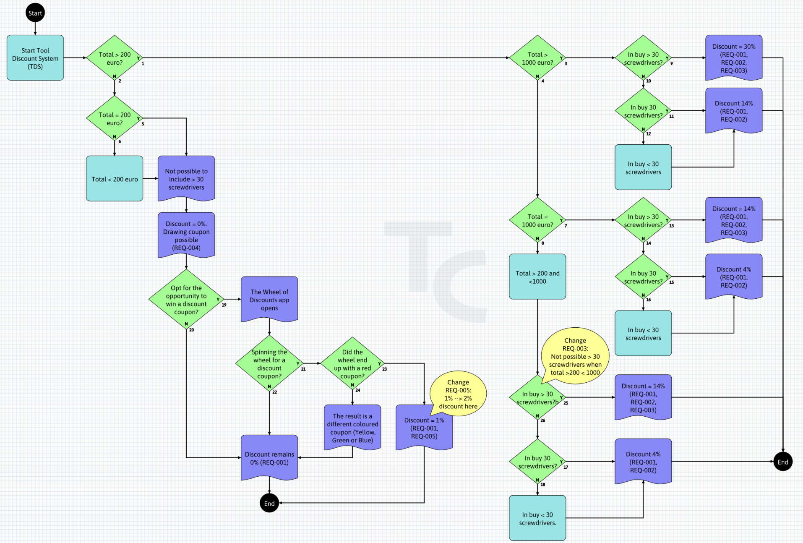

[← Back to Documentation Index](index.md)

# Behavioural Modelling

Modelling is the foundation of early Model-Based Testing (eMBT).  
In TestCompass, a model represents the intended behaviour of a system in a clear, structured, and explicit way.  
It serves as an **Intent-Driven shared thinking tool** for business and technical stakeholders, enabling early discovery of ambiguities, risks, and implicit assumptions.

> **Core Purpose**  
> Modelling makes intended system behaviour explicit, replacing hidden assumptions with a shared visual reference that captures true stakeholder intent, drives early risk discovery, and enables automated, coverage-based test design.

This page explains the conceptual principles behind modelling in TestCompass and how models support systematic test generation, impact analysis, and collaborative understanding.

---

## Purpose of Modelling

A model makes behaviour explicit.  
Instead of relying on unwritten assumptions, vague specs, or scattered user stories, the visual model provides a single *source of truth* for:

- business rules and decision logic  
- user flows and process outcomes  
- boundary conditions and data variations  
- exceptional behaviour and error handling
- ... 

By externalising behaviour, teams can reason more clearly, validate stakeholder intent earlier, and avoid costly rework long before code is written.

---

## Universal Readability & Near-Zero Learning Curve

One of the greatest advantages of TestCompass is its **extreme accessibility and intuitive design**:

- **Readable by Everyone:** Visual models act as a universal language (*lingua franca*) for both technical and non-technical stakeholders, including Product Owners, Business Analysts, Developers, and Testers.
- **Near-Zero Learning Curve:** Unlike traditional, highly technical MBT tools, TestCompass uses simple, standardized flowchart principles that anyone can understand and create within minutes.
- **Frictionless Usability:** Building and modifying models is fast, lightweight, and user-friendly—ideal for live refinement sessions, "Three Amigos" discussions, and active team collaboration.

---

## AI-Assisted Kickstart (AAMC)

To lower the onboarding barrier even further, TestCompass includes **AI-Assisted Model Creation (AAMC)**:

- **Instant Model Generation:** Instead of starting from a blank canvas, teams can transform raw text, user stories, acceptance criteria, decision tables, etc into a fully structured visual test model draft within seconds.
- **Human-in-the-Loop:** AAMC provides a solid concept model, allowing the team to focus immediately on refining logic, exploring edge cases, and validating business intent together.

➡️ **Learn more:** [AAMC – AI-Assisted Model Creation](aamc.md)

---

## Modelling Principles

TestCompass uses a lightweight, expressive modelling style based on flowchart logic.  
The goal is not to create a complex architectural diagram, but to build a **shared understanding of business intent**.

Key principles:

- **High-level abstraction:** Models must remain understandable for both business and IT.  
- **Explicit decisions:** Every decision is represented visually, making happy paths and alternative/unhappy paths fully visible.  
- **Clear outcomes:** Each path leads to a result that reflects observable system behaviour.  
- **No hidden assumptions:** Unclear logic or missing requirements are immediately exposed on the canvas.  
- **Iterative refinement:** Models evolve as requirements become clearer.  

---

## Node Types

TestCompass offers a focused set of node types to keep models simple, expressive, and testable:

- **Start:** The entry point of the behaviour. A model always begins with exactly one Start node.  
- **Action / State:** Represents an action or a state in the flow. Has exactly one outgoing transition.  
- **Decision:** Represents a branching point with two explicit outcomes: `Yes` and `No`. Decision branches are classified as test paths and form the basis for mathematical coverage generation.  
- **Result:** Represents an expected outcome or observable effect.  
- **End:** Represents the termination of a path. A model must contain at least one End node.  
- **Sticky Notes (In-Tool Discovery):** Dedicated nodes used during collaborative Example Mapping or Feature Mapping sessions directly on the canvas to capture rules, examples, triggers, and open questions.  
- **Comment / Balloon Nodes:** Used to capture questions, ambiguities, or open risks. Comments serve as review prompts (or are generated during AI Reflection loops with AAMR).  

  

---

## Node Details: Preconditions, Data & Predictions

To transform visual flows into executable test specifications, nodes can be enriched with detailed properties in their details panel:

- **Preconditions:** Initial system states required before executing a path.  
- **Test Data Variations:** Specific data inputs, boundary values, or variables.  
- **Predictions (Expected Results):** Verifiable system outputs and state changes.  

### Physical Test Scenarios vs. BDD Outlines
The depth of details defined in your nodes determines the generated test artifacts:

1. **Physical Test Scenarios:** When concrete test data, preconditions, and predictions are added to nodes, TestCompass generates detailed physical test matrices, including complete **Excel Test Design** sheets. 
2. **Data-Driven BDD Outlines:** When modelling for BDD, data variations in nodes automatically generate structured Gherkin **`Scenario Outline`** specifications complete with populated **`Examples:`** tables.

---

## Model Validation

TestCompass automatically validates the structural integrity of your model to ensure it is logically sound.  
Automated checks include:

- missing or broken transitions  
- nodes with invalid numbers of incoming or outgoing connections  
- unreachable model paths or dead ends  
- missing Start or End nodes  
- structural inconsistencies in decision logic  

These validations act as a guardrail, detecting structural defects before you generate test suites or export artifacts.  
*(Note: Validation supports structural correctness, while team review validates true business intent.)*

---

## Model & Project Management

TestCompass provides flexible options for managing, sharing, and versioning your models and project structures:

- **Project Import & Export:** Export entire project environments, including all associated models, settings, and metadata, to easily share setups between teams, create backups, or migrate configurations.
- **Model Import & Export:** Import and export individual models in both native `.tcmodel` JSON formats and open Mermaid (`.mmd`) text syntax for seamless documentation sync.
- **Model Versioning (Save as New Version):** Save models as distinct new versions as requirements evolve. This creates clear audit trails, allows you to compare structural changes over time, and supports reliable historical tracking.

---

## Modelling Workflow

Modelling follows a continuous, iterative workflow aligned with the eMBT framework:

1. **Exploratory (Discovery):** Run Example Mapping using Sticky Note nodes on the canvas, draft visual models manually, or generate initial flows using AAMC from user stories.  
2. **Review (Reflection):** Review the visual model with the team and challenge assumptions using **AAMR (AI Reflection)** to uncover missing edge cases and risks.  
3. **Coverage (Design):** Derive mathematical coverage-based test suites (Node, Edge, Path Pair, Path Triple, or Full Path Coverage) as Excel Test Design, Decision Tables, or Gherkin `.feature` files.  
4. **Checking (Execution Alignment):** Feed generated test artifacts into your test management tools (Azure DevOps, Jira, Zephyr, Xray) or test automation frameworks like Cucumber, SpecFlow, Playwright or Cypress.  

---

## Collaborative Discovery & BDD

TestCompass supports collaborative requirements discovery practices such as **Feature Mapping** and **Example Mapping** (aligned with BDD principles). Discovery artifacts captured on the canvas seamlessly translate into explicit behavioural models, enabling automated, coverage-based Gherkin feature file generation.

➡️ **Read the full guide:** [BDD Requirements Discovery & Formulation](bdd-discovery.md)

---

## Modelling with Gherkin

To seamlessly translate discovery maps into executable BDD specifications, TestCompass natively supports Gherkin keywords directly on the visual canvas:

- `Feature`  
- `Background`  
- `Rule`  
- `Given` / `When` / `Then`  
- `And` / `But`  
- `Examples`  

This allows teams to generate clean coverage-based Gherkin feature files directly from the visual model, ensuring executable specifications stay 100% aligned with the underlying business logic.

---

## Modelling with Mermaid

TestCompass supports open, text-based modelling through Mermaid:

- Import Mermaid diagrams (or converted Visio/BPMN models) and instantly transform them into testable eMBT models.  
- Export visual models back to Mermaid for documentation, pull requests, or version control repository storage.  

---

## Relationship to Test Generation & Impact Analysis

- **Systematic Test Generation:** A well-structured model allows TestCompass to calculate optimal path coverage based on mathematical algorithms, eliminating manual test case writing.  
  ➡️ **Learn more:** [Test Generation and Coverage](test-generation.md)

- **Effortless Impact Analysis:** When requirements change, you update the visual model—not the test cases. TestCompass automatically detects added, removed, updated, and unchanged test scenarios.  
  ➡️ **Learn more:** [Impact Analysis](impact-analysis.md)

---

> **Key Takeaway**  
> Modelling in TestCompass is designed for everyone, combining an intuitive visual canvas, zero learning curve, in-tool discovery, and AI assistance to turn business intent into complete, coverage-based test specifications.

---

## Navigation

⬅️ **[Back to Documentation Index](index.md)**
