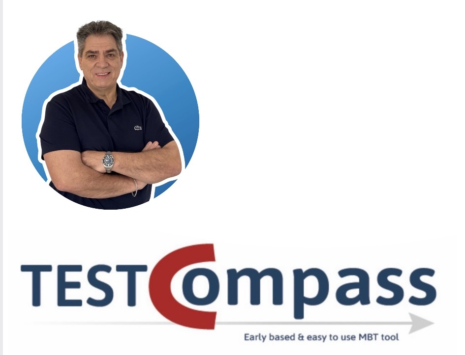

[← Back to Documentation - Home](index.md)

# Overview

TestCompass is an early Model-Based Testing (eMBT) platform designed to help teams reason clearly, uncover risks early, and build shared understanding before development begins.  
It brings together explicit behavioural modelling, AI-assisted model creation and reflection, and open, text-based modelling through Mermaid.

> 🎯 **Core Purpose**  
> TestCompass empowers teams to replace hidden assumptions with explicit behavioural models, enabling early risk discovery, shared understanding, and systematic test generation before code is written.

This overview explains the purpose of TestCompass, the principles behind early MBT, and how the platform supports a structured, collaborative testing workflow.

  

---

## Why early Model-Based Testing?

Many issues in software projects originate from unclear or incomplete requirements.  
eMBT addresses this by making behaviour explicit early in the process, enabling teams to:

- reduce ambiguity  
- avoid hidden assumptions  
- identify risks sooner  
- validate understanding with business and IT  
- generate systematic, reproducible tests  

TestCompass supports this approach by providing a modelling environment that is easy to understand for all stakeholders, while still precise enough for deep testing.

➡️ **Learn more:** [The eMBT Approach](eMBT-approach.md)

---

## What TestCompass Provides

TestCompass offers a complete workflow for early MBT:

- **Explicit behavioural modelling** — Create clear, structured models that represent system behaviour and decisions.  
- **AI-assisted modelling** — Use AAMC to generate an initial model draft and AAMR to reflect on the model and uncover assumptions.  
- **Automatic test generation** — Generate test scenarios based on multiple coverage strategies, from minimal sets to full path coverage.  
- **Impact analysis** — Understand how requirement changes affect existing tests and models.  
- **Open standards** — Import and export Mermaid diagrams for collaboration, documentation, and version control.  
- **Integrations** — Connect with Azure DevOps, Jira, Zephyr, Xray, and other test management tools.  

---

## How TestCompass Fits into the Development Workflow

TestCompass is designed to support modern, iterative development practices:

- Works naturally with version-controlled repositories  
- Encourages early collaboration between business and IT  
- Supports refinement, BDD-style conversations, and shift-left testing  
- Produces artefacts that are traceable, reviewable, and easy to maintain  

The result is a shared understanding of behaviour before development begins—reducing rework, improving quality, and strengthening team alignment.

---

## What This Documentation Covers

This documentation provides conceptual guidance, examples, and background information on:

- [The eMBT Approach](eMBT-approach.md)
- [Behavioural Modelling](modelling.md)  
- [Test Generation and Coverage](test-generation.md)  
- [Impact Analysis](impact-analysis.md)  
- [Integrations](integrations.md)  
- [Export Formats](export-formats.md)
- [AAMC – AI-Assisted Model Creation](aamc.md)
- [AAMR – AI-Assisted Model Reflection](aamr.md)
- [Mermaid Import and Export](mermaid-import-export.md)

*(Note: This documentation does **not** replace the in-product Quick Start Guide or instructional videos, which provide step-by-step UI instructions.)*

---

> 🚀 **Key Takeaway**  
> By bridging the gap between requirements, explicit models, and automated test generation, TestCompass helps teams build the right thing and build it right from day one.
