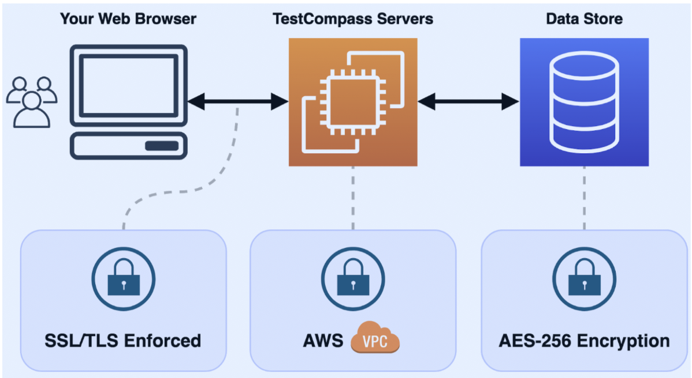

# Security & Architecture Overview

TestCompass is built as a secure, cloud-based SaaS platform designed to meet professional enterprise standards. We take the security, privacy, and integrity of your test models and account data seriously.

Below is an overview of the core security, hosting, and data protection measures implemented within the TestCompass infrastructure.

  

---

## Network Traffic & Encryption

All communication between your web browser and the TestCompass backend is secured using industry-standard encryption protocols:

- **HTTPS / TLS Enforced:** All connections are made using **HTTPS**, ensuring that network traffic is fully encrypted via **SSL/TLS (Secure Sockets Layer / Transport Layer Security)**. This prevents third parties from intercepting or tampering with data transmitted between your local machine and the TestCompass infrastructure.

---

## Backend Infrastructure & Hosting

TestCompass's backend infrastructure is hosted on **AWS (Amazon Web Services)**, the world's leading cloud hosting provider trusted by global banks, financial institutions, tech companies, governments, and security services.

- **European Data Residency:** All TestCompass infrastructure and data storage are **physically located within the European Union (EU - Frankfurt region)**.
- **VPC & Firewall Protection:** Our systems are containerized and firewalled using AWS **VPC (Virtual Private Cloud)** technology.
- **Access Control:** Access is strictly secured using AWS **IAM (Identity and Access Management)** frameworks.
- **Security Best Practices:** All backend resources are configured in strict accordance with industry security best practices and AWS security guidelines.

---

## Data Storage & Backup

Your test models, project configurations, and user account information are protected at rest and against data loss:

- **Encryption at Rest:** All TestCompass customer data is encrypted at rest using industry-standard **AES-256 encryption**.
- **Automated Backups:** Regular, secure backups are performed continuously to safeguard against data loss and ensure platform reliability.

---

## Business Continuity, Disaster Recovery & Data Disposal

TestCompass maintains clear operational procedures to guarantee high platform availability and responsible data lifecycle management.

### Business Continuity & High Availability
- **Multi-AZ Deployment:** Core database instances and application services are deployed across multiple Availability Zones (Multi-AZ) within AWS EU to maintain continuous uptime and automatic failover in the event of localized infrastructure issues.
- **Proactive Monitoring:** AWS CloudWatch continuously aggregates performance metrics and system alerts to detect and resolve potential issues proactively.

### Disaster Recovery
- **Snapshot Retention:** Daily database backups are securely retained for a rolling 7-day period.
- **Automated Failover:** Standby instances are kept in continuous sync, allowing automatic recovery with minimal operational disruption.

### Data Disposal & Privacy (GDPR)
- **Account Purging:** When a user or workspace account is deleted, all associated test models, project configurations, and personal account data are permanently removed from active databases.
- **Backup Lifecycle:** Data existing within daily automated backups is permanently purged and overwritten in alignment with our 7-day backup retention policy.

---

## Questions or Enterprise Security Reviews?

If your organization requires a detailed security assessment, vendor risk review, or has specific compliance questions regarding TestCompass, please get in touch with us via [our website](https://www.compass-testservices.com).
