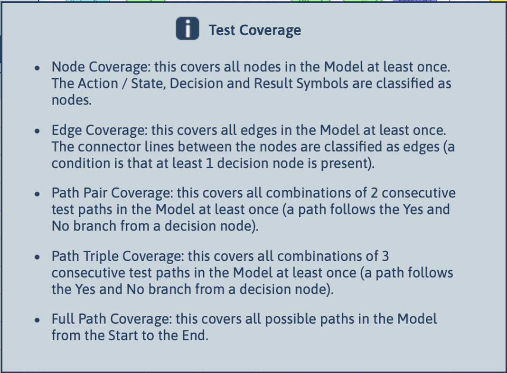

[← Back to Documentation Index](index.md)

# Test Generation

Test generation in TestCompass is based on the principle that explicit behavioural models enable systematic, reproducible, and risk-aligned testing. Once a model has been validated and reviewed, TestCompass can automatically generate test scenarios using a selected coverage strategy.

> **Core Purpose**  
> Test generation transforms validated behavioural models into systematic, reproducible test scenarios, ensuring your test suite covers the right decisions, paths, and risk levels without manual rewriting.

This page explains the conceptual foundations of test generation and describes the coverage forms supported by TestCompass.

---

## Purpose of Test Generation

The goal of test generation is to derive a set of test scenarios that:

- reflect the intended behaviour of the system
- cover the relevant decisions, paths, and boundaries
- are reproducible and traceable
- align with the agreed level of risk and thoroughness

Because tests are generated directly from the model, they remain consistent, structured, and easy to maintain.

---

## Abstract vs. Concrete Test Scenarios

TestCompass distinguishes between two types of scenarios:

- **Abstract test scenarios:** generated directly from the model. They describe the logical flow and help teams understand behaviour, explore ideas, and ask questions.
- **Concrete test scenarios:** created when preconditions, data, or concrete values are added. These scenarios are executable and suitable for manual or automated testing.

This separation ensures clarity: the model defines behaviour, while concrete details are added only when needed.

---

## Coverage Strategies

TestCompass supports multiple coverage strategies, ranging from lightweight to exhaustive. Each strategy defines **what must be covered at least once** in the generated test set.

The following coverage forms are available:

### Node Coverage (NC)
Covers **all nodes** in the model at least once. Nodes include Action/State, Decision, and Result nodes. This is the lightest form of coverage.

### Edge Coverage (EC)
Covers **all edges** in the model at least once. Edges represent the transitions between nodes, including Yes/No branches.

### Path Pair Coverage (PPC)
Covers **all combinations of two consecutive test paths**. A test path follows the Yes or No branch from a decision node. This strategy captures interactions between consecutive decisions.

### Path Triple Coverage (PTC)
Covers **all combinations of three consecutive test paths**. This is useful when decisions influence each other across multiple steps.

### Full Path Coverage (FPC)
Covers **all possible paths** from Start to End. This is the strongest form of coverage and typically produces the largest number of scenarios.

  

---

## Live Coverage Calculation & Disabling Scenarios

TestCompass gives you immediate visual insight into your actual test thoroughness:

- **Real-Time Coverage Percentage:** as soon as a coverage strategy (such as Edge Coverage or Path Pair Coverage) is selected, TestCompass automatically calculates and displays your exact coverage percentage.
- **Dynamic Recalculation (Disabled Scenarios):** in practical testing, certain generated paths may be out of scope, redundant, or deferred to a later release. When you disable specific test scenarios, TestCompass automatically updates and recalculates the live coverage percentage in real time.

This ensures you always have a transparent view of your active test coverage before exporting artifacts to your test management tools.

---

## Maximum Number of Test Scenarios

Models may contain loops or complex branching, which can theoretically produce an infinite number of paths. To ensure practical generation:

- TestCompass prioritises paths that contribute to coverage
- loops are explored in a controlled manner
- redundant paths are pruned
- a configurable maximum number of scenarios is applied

This ensures that generated scenarios are meaningful, non-redundant, and aligned with the selected coverage strategy.

---

## Risk-Driven Coverage Selection & PRA

Often, test scoping is governed by formal Product Risk Analysis (PRA) and Risk-Based Testing (RBT) frameworks. 

TestCompass and early Model-Based Testing (eMBT) do not replace PRA; they make risk-driven testing actionable, visual, and measurable.

### Aligning PRA Outcomes with Test Compass Coverage
Rather than applying the same coverage strategy across an entire system, teams use the model to align formal coverage metrics directly with identified risk levels:

- **High Risk (PRA High):** apply deep coverage strategies such as Path Pair Coverage (PPC) or Full Path Coverage (FPC). This ensures that complex state transitions, edge cases, and business-critical decision chains are fully validated.
- **Medium Risk (PRA Medium):** apply Edge Coverage (EC) to guarantee that every decision outcome and branch transition is exercised at least once.
- **Low Risk (PRA Low):** apply lightweight Node Coverage (NC) to confirm basic functional execution without over-engineering test suites.

### Adjusting Scope When Time is Tight
When a release deadline approaches and time or capacity is limited, eMBT lets you adjust your test scope on the fly:

- **Disabling Low-Risk Paths:** temporarily turn off low-risk paths or optional features directly on your visual model.
- **Instant Recalculation:** TestCompass instantly updates your test suite, keeping only the scenarios you actually need without losing track of your changes.

> **Key Takeaway**  
> Risk analysis tells you where to focus your testing. eMBT gives you a visual model to instantly turn those choices into a clean, actionable test suite.
> 
---

## Exporting Test Scenarios

Generated test scenarios can be exported to:

- Excel test design
- Excel decision tables
- Gherkin feature files
- CSV, for import into different Test Management Systems like Jira and Azure DevOps Test Plans

Exports include:

- node text
- decision logic
- expected results
- preconditions and data (if provided)

➡️ **See:** [Export Formats](export-formats.md)

---

## Relationship to Modelling

The quality of generated tests depends directly on the quality of the model. Clear decisions, explicit boundaries, and well-defined outcomes lead to stronger and more meaningful test scenarios.

➡️ **Learn more:** [Modelling](modelling.md)

---

## Relationship to Impact Analysis

When requirements change, you update the model rather than the tests. Impact analysis identifies which scenarios are:

- added
- removed
- updated
- unchanged

This keeps test suites aligned with evolving behaviour.

➡️ **Learn more:** [Impact Analysis](impact-analysis.md)

---

➡️ **Looking for BDD & Gherkin Generation?** Read the [BDD Discovery & Gherkin Integration Guide](bdd-discovery.md).

---

> **Key Takeaway**  
> Test generation in TestCompass ensures that testing is systematic, transparent, and grounded in explicit behavioural understanding rather than hidden assumptions.

---

## Navigation

⬅️ **[Back to Documentation Index](index.md)**
